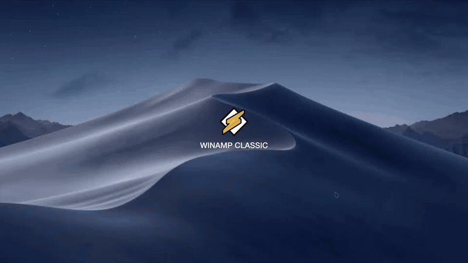
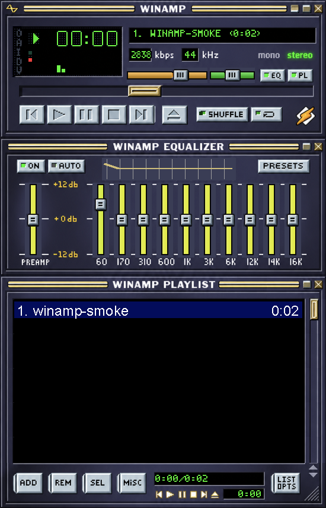

# Winamp Classic for macOS

Нативный аудиоплеер для Mac с интерфейсом по образцу классического Winamp 2.x: три панели, сегментный дисплей, спектроанализатор и десятиполосный эквалайзер.

## Как выглядит и работает

[](https://github.com/fanfandesign/winamp-classic-macos/releases/download/v1.1/Winamp-Classic-Demo-AE.mp4)

**[Смотреть ролик со звуком — 12 секунд, Full HD](https://github.com/fanfandesign/winamp-classic-macos/releases/download/v1.1/Winamp-Classic-Demo-AE.mp4)**

Запуск с иконки, воспроизведение, настройка эквалайзера и громкости. Нажмите на анимированное превью, чтобы открыть видео с музыкой и щелчками.

## Скачать и установить

**[Скачать Winamp Classic 1.1 для macOS](https://github.com/fanfandesign/winamp-classic-macos/releases/download/v1.1/Winamp-Classic-1.1-Universal.dmg)** · [Все релизы](https://github.com/fanfandesign/winamp-classic-macos/releases)

Для **Apple Silicon и Intel**, требуется **macOS 13 Ventura или новее**.
Откройте DMG, перетащите приложение в Applications (Программы), извлеките диск и запустите плеер из Программ.

**Сборка без нотарификации Apple:** macOS может заблокировать первый запуск после скачивания. Это предварительная версия с ad-hoc подписью. Приложение не отключает защиту macOS. Информация о Developer ID: [Apple](https://developer.apple.com/developer-id/).



## Запуск из исходников

После сборки откройте `build/Winamp Classic.app`. Для добавления музыки перетащите аудиофайлы в окно или нажмите ADD / ⌘O. Двойной щелчок по треку запускает его. Приложение работает локально, без сервера и зависимостей.

Форматы: MP3, WAV, AIFF, AAC/M4A, FLAC и прочие аудиоформаты, которые декодирует AVFoundation macOS. Защищённые DRM-файлы не поддерживаются.

## Управление

- Пробел — воспроизведение / пауза; стрелки влево / вправо — перемотка на 5 секунд.
- Z / X / C / V / B — предыдущий / воспроизвести / пауза / стоп / следующий.
- Enter — воспроизвести выбранный трек, Delete — удалить его из плейлиста (файл остаётся на диске).
- ⌘O — добавить музыку; ⌘S — сохранить плейлист M3U8.
- EQ / PL или ⌘E / ⌘L — скрыть / показать панели.
- ⌘2 — переключить масштаб 1× / 2× / 3×. Стартовый масштаб — 1×: окно 275 × 428 точек, близко к оригинальному Winamp.
- Перемещение окна — за заголовок любой панели.
- Щелчок по времени — прошедшее / оставшееся время.
- SHUFFLE — случайный порядок; ↻ — повтор всего плейлиста.
- REM — удалить выбранную запись или очистить список; MISC — сортировка и масштаб.
- LIST — загрузка / сохранение плейлиста; SEL — переход к играющему треку.
- ON включает обработку эквалайзером; AUTO сохраняет и восстанавливает настройки EQ для каждого трека; PRESETS предлагает Flat, Bass boost и Rock.
- Правый щелчок открывает меню с основными действиями.

Плейлист, громкость и настройки эквалайзера сохраняются между запусками. Окно намеренно без стандартной рамки macOS. Растровые элементы классического скина загружаются из ресурсов приложения. Панели составляют одно окно. AUTO запоминает EQ по треку; настройки меняются вручную или через PRESETS.

## Сборка

Сборка для Apple Silicon, macOS 13+. Нужны Apple Command Line Tools со Swift:

```sh
./build.sh
```

Результат: `build/Winamp Classic.app`. Локальная подпись ad-hoc; сертификат Apple Developer для запуска на этом Mac не требуется. Для распространения нужна отдельная подпись и нотарификация.

## Проверка

```sh
"build/Winamp Classic.app/Contents/MacOS/WinampClassic" --smoke-test
```

Проверка создаёт двухсекундный WAV в `/tmp`, проверяет загрузку, воспроизведение, паузу, перемотку, изменение полосы EQ, bypass, продолжение, остановку, удаление записи и отрисовку окна. Снимок окна: `/tmp/winamp-preview.png`.

## Источники графики

Классический скин base-2.91 и вырезанные растровые элементы: [Webamp](https://github.com/captbaritone/webamp), `packages/webamp/assets/skins/base-2.91.wsz` и `packages/webamp/css/base-skin.css`. Графика классического Winamp сохраняет права исходных правообладателей. Приложение является независимым проектом и не связано с Winamp.

## Нажатия кнопок

Кнопки транспорта, EQ/PL, shuffle/repeat и переключатели эквалайзера используют HD-графику с обратным скосом и тенью для нажатого состояния. Ползунки меняют состояние при перетаскивании. Кнопки плейлиста получают утопленную рамку. Действие кнопки выполняется при отпускании мыши внутри неё; увод курсора за пределы отменяет нажатие.

HD-скин создан встроенным генератором изображений и подключён из `Resources/HD/classic-remastered.png` (1005 × 1565 пикселей). Логический размер окна остаётся 275 × 428. Нажатые состояния созданы встроенным генератором отдельным HD-листом из 24 кнопок и ручек (`Resources/HD/buttons-pressed.png`, 1836 × 857 пикселей). Во время удержания показываются сгенерированные утопленные грани, внутренние тени и значки. Резервная кодовая отрисовка остаётся для мини-кнопок транспорта. Исходные спрайты сохранены для пиксельных шрифтов и резервной отрисовки. Промпты и сведения о генерации: `Resources/HD/generation.json`.

## Меню, бегущие строки и отступы

Внутренние меню используют классическую прямоугольную рамку, компактные пункты и синее выделение. Доступны мышь, стрелки, Enter и Escape. Длинные названия прокручиваются в дисплее и выбранной строке плейлиста, с паузой в начале. Короткие названия стоят на месте, кириллица поддерживается.

У времени, битрейта и частоты выделены отдельные области с внутренними отступами; длинные значения вписываются в поле. Ширина названия в плейлисте учитывает фактическую длину длительности. Мини-кнопки и нижний таймер разделены промежутком. Визуальная проверка включает масштабы 1×, 2× и 3×, длинные названия и большие значения времени.

## Иконка приложения

Классическая оранжевая молния Winamp на прозрачном фоне используется в Dock и Finder. В ICNS включены размеры от 16 до 1024 пикселей. Источник: [Winamp-logo.svg](https://commons.wikimedia.org/wiki/File:Winamp-logo.svg), Emrrans / Pduive23, [CC BY-SA 3.0](https://creativecommons.org/licenses/by-sa/3.0/); логотип масштабирован и вписан в квадрат. Сведения об авторстве включены в приложение (`WinampIconCredits.txt`). Пересборка иконки: `python3 Resources/make_icon.py`.

## Установочный DMG и GitHub Releases

Готовый установочный файл создаётся командой:

```sh
./release.sh
```

По умолчанию получается **Universal**-приложение для Apple Silicon и Intel с macOS 13 Ventura и новее. Файл — `dist/Winamp-Classic-1.1-Universal.dmg`. Пользователь открывает DMG, перетаскивает приложение в Applications, извлекает диск и запускает плеер из Программ. Дополнительные библиотеки, Swift и Xcode на компьютере пользователя не нужны.

Сборка без Apple Developer использует **ad-hoc подпись и не нотарифицирована**. После скачивания через браузер Gatekeeper может заблокировать первый запуск. Такой DMG подходит для предварительного распространения; он не гарантирует беспрепятственный запуск на другом Mac. Приложение и установщик не отключают защиту macOS. См. [документацию Apple о Developer ID](https://developer.apple.com/developer-id/).

В `dist/` также появляются контрольная сумма SHA-256 и описание релиза. Проверка файла:

```sh
cd dist
shasum -a 256 -c Winamp-Classic-1.1-Universal.dmg.sha256
```

На GitHub установщик размещают в **Releases**, а не в списке файлов исходного кода:

1. Создайте публичный репозиторий (можно с одним README). Для скачивания DMG публиковать исходники необязательно. Если загружаете исходники проекта, `build/`, `dist/` и секреты исключены через `.gitignore`.
2. В репозитории откройте **Releases → Draft a new release** и задайте тег `v1.1`.
3. Прикрепите DMG и файл `.sha256`, скопируйте текст из `dist/RELEASE_NOTES.md`, укажите, что сборка без нотарификации.
4. Опубликуйте релиз. Пользователи скачивают DMG из раздела **Assets**.

В проекте есть `.github/workflows/release.yml`: ручной запуск через Actions создаёт Universal DMG как артефакт сборки; отправка тега `v*` дополнительно создаёт **черновик** GitHub Release. Workflow не публикует релиз автоматически и без дополнительной настройки создаёт только ad-hoc сборки. Версию в `Resources/Info.plist` следует менять перед новым тегом.

### Подпись и нотарификация позднее

Скрипты уже поддерживают Developer ID и профиль учётных данных `notarytool`, хранящийся в Связке ключей:

```sh
WINAMP_SIGN_IDENTITY='Developer ID Application: Your Name (TEAMID)' \
WINAMP_NOTARY_PROFILE='winamp-notary' \
./release.sh
```

В таком режиме приложение подписывается с hardened runtime и timestamp; DMG подписывается, отправляется в Apple, получает прикреплённый билет нотарификации и проверяется через `stapler`. Сертификаты и пароли в репозиторий добавлять нельзя. Учётные данные профиля настраиваются владельцем Apple Developer через `xcrun notarytool store-credentials`.

Для отдельной архитектуры можно указать `WINAMP_ARCHS=arm64` или `WINAMP_ARCHS=x86_64`. Universal-файл проверяется по обеим архитектурам; функциональная проверка выполняется на доступном Mac с Apple Silicon. Запуск на отдельном Intel Mac ещё требует проверки.
